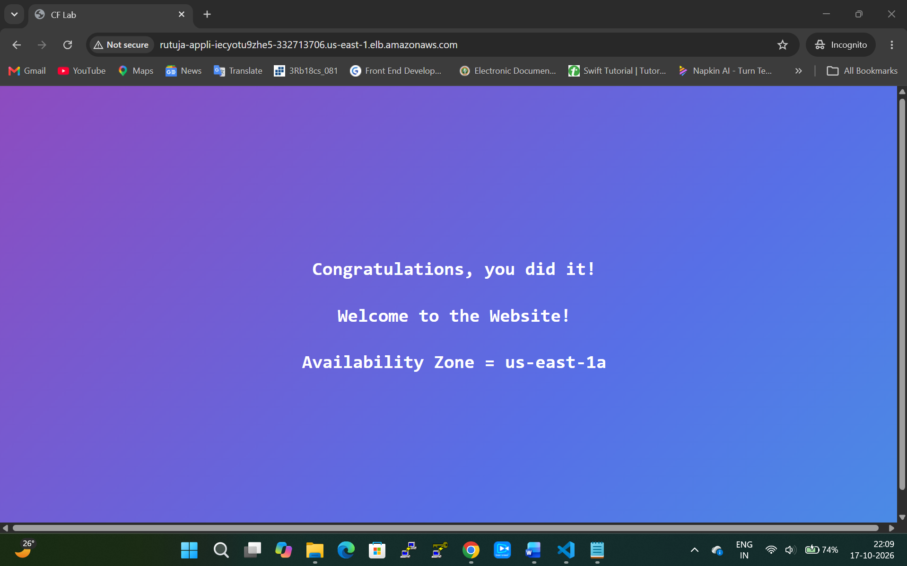

# Broken Web App Challenge: Resolution Documentation

> Troubleshooting a **504 Gateway Time-out** on an Application Load Balancer, deployed with AWS CloudFormation.


**Author:** Rutuja Naik
**LinkedIn:** [rutuja-naik07](https://www.linkedin.com/in/rutuja-naik07/)

---

## Table of Contents

1. [Overview](#overview)
2. [Architecture and Services Used](#architecture-and-services-used)
3. [Step 1: Deploy the CloudFormation Stack](#step-1-deploy-the-cloudformation-stack)
4. [Step 2: Resolve the Four Configuration Issues](#step-2-resolve-the-four-configuration-issues)
5. [Verification](#verification)
6. [Key Learnings](#key-learnings)
7. [Troubleshooting Checklist](#troubleshooting-checklist)
8. [Repository Structure](#repository-structure)

---

## Overview

This project documents the step-by-step resolution of the **Broken Web App Challenge**, deployed via AWS CloudFormation. The goal of the lab was to identify and fix the configuration issues preventing an application behind an Application Load Balancer (ALB) from loading properly, which resulted in a **504 Gateway Time-out** error.

| Item | Details |
|---|---|
| Region | US-EAST-1 (N. Virginia) |
| Deployment | AWS CloudFormation |
| Symptom | 504 Gateway Time-out on the ALB |
| Issues found | 4 configuration problems |
| Final result | Targets Healthy, application loads successfully |

## Architecture and Services Used

- **AWS CloudFormation**: deploys the lab environment
- **Application Load Balancer (ALB)**: receives public traffic on port 80
- **Target Group**: routes traffic to the EC2 instances and runs health checks
- **Amazon EC2**: backend web servers
- **Security Groups**: control inbound traffic to the ALB and the instances
- **VPC Subnets**: public and private subnet placement for the ALB

```
Internet --> ALB (public subnet, ALB security group)
                |
                v
          Target Group (health check: /index.html)
                |
                v
          EC2 instances (security group allows port 80 from the ALB security group)
```

---

## Step 1: Deploy the CloudFormation Stack

1. **Open the CloudFormation console** in the **US-EAST-1 (N. Virginia)** region.
2. Select **Create stack**, then **With new resources (standard)**.
3. Under **Template source**, choose **Amazon S3 URL** and provide the template URL:

   ```
   https://cloud-mastery-bootcamp.s3.amazonaws.com/lab-guides/solutions-architecture/broken-web-app-challenge.json
   ```
4. Name the stack using your first name (for example, `Rutuja`), accept the defaults, and submit.
5. Wait until the stack status shows **CREATE_COMPLETE**.

---

## Step 2: Resolve the Four Configuration Issues

### Issue 1: Target Group Health Check Path Mismatch / Typo

**Problem:** The health check path was misconfigured (a typo), so the ALB could not get a valid response and marked the EC2 instances as **Unhealthy**. The instances also needed to be added as targets.

**Resolution:**

1. Go to **EC2 > Target Groups** and open the target group.
2. Open the **Health checks** tab and click **Edit**.
3. Change the health check path to `/index.html` and save.
4. Open the **Targets** tab and select **Register targets**.
5. Choose the available EC2 instances, add them as **pending** targets below, and save.

### Issue 2: Application Load Balancer Security Group and Subnet Settings

**Problem:** The ALB security group did not allow the required inbound traffic, and the ALB was attached to a private subnet, so it was not reachable from the internet.

**Resolution:**

1. Go to **EC2 > Load Balancers** and open the ALB.
2. **Security group:** check the attached security group and edit its **Inbound rules** to add **SSH** and **HTTP**.
3. **Subnets:** open the **Network mapping** section and click **Edit subnets**.
4. Change the subnet selection from the **private subnet** to a **public subnet** and save.

### Issue 3: Security Group Port 80 Rule (Source Restriction)

**Problem:** The existing port 80 rule did not use the correct source, so traffic from the load balancer was not being accepted.

**Resolution:**

1. Go to **EC2 > Security Groups** and open the security group.
2. Delete the existing **port 80** inbound rule.
3. Add a new **HTTP (port 80)** rule with Source type **Custom**.
4. Set the source to the **load balancer's security group** (search for the ID starting with `sg-`) and save.

### Issue 4: EC2 Instance Security Group Ingress Rules

**Problem:** The EC2 backend instances did not have the required inbound ports open, which caused connection timeouts (504 Gateway Time-out).

**Resolution:**

1. Go to **EC2 > Instances** and select the instance.
2. Open the **Security** tab and go to the attached security group to edit its **Inbound rules**.
3. Add the **HTTP (port 80)** and **SSH (port 22)** rules and save.

---

## Verification

1. In the target group, confirm the target status is **Healthy**.
2. Copy the **ALB DNS name** from the load balancer details.
3. Open a new **Incognito** tab, paste the DNS name, and remove the "s" from `https` so the URL starts with `http://` (the ALB listener serves HTTP on port 80).
4. The application loads without errors and shows the success page.



*The application loading successfully through the ALB DNS name, served from Availability Zone `us-east-1a`.*

---

## Key Learnings

- A 504 error often means the problem is between the load balancer and the backend, not in the application code.
- Security group rules and subnet placement matter as much as the application configuration.
- Referencing a security group as the source (instead of an IP range) is a cleaner way to allow ALB-to-instance traffic.
- Checking target group health and target status first saves a lot of debugging time.

## Troubleshooting Checklist

Use this list for similar ALB 504 errors:

- [ ] Are the targets registered in the target group?
- [ ] Is the health check path valid (for example `/` or `/index.html`)?
- [ ] Is the ALB in **public** subnets?
- [ ] Does the ALB security group allow inbound HTTP from the internet?
- [ ] Does the instance security group allow port 80 from the ALB security group?
- [ ] Is the web server running on the instances?

---

## Repository Structure

```
broken-web-app-challenge/
├── README.md
├── LICENSE
├── images/
│   └── final-result.png
└── docs/
    ├── Broken_Web_App_Challenge_Resolution.pdf
    └── Broken_Web_App_Challenge_Resolution.docx
```

## Connect

If you found this helpful, feel free to connect with me on [LinkedIn](https://www.linkedin.com/in/rutuja-naik07/).
